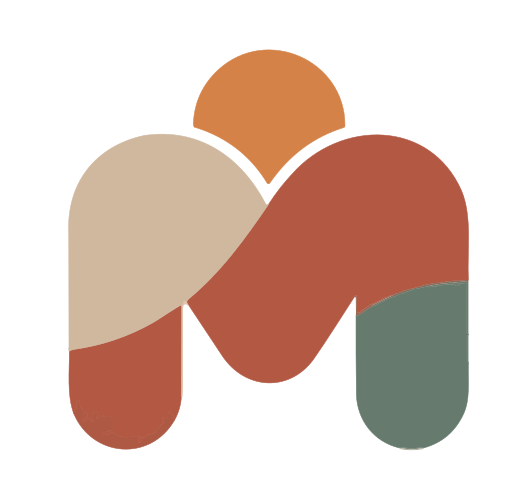
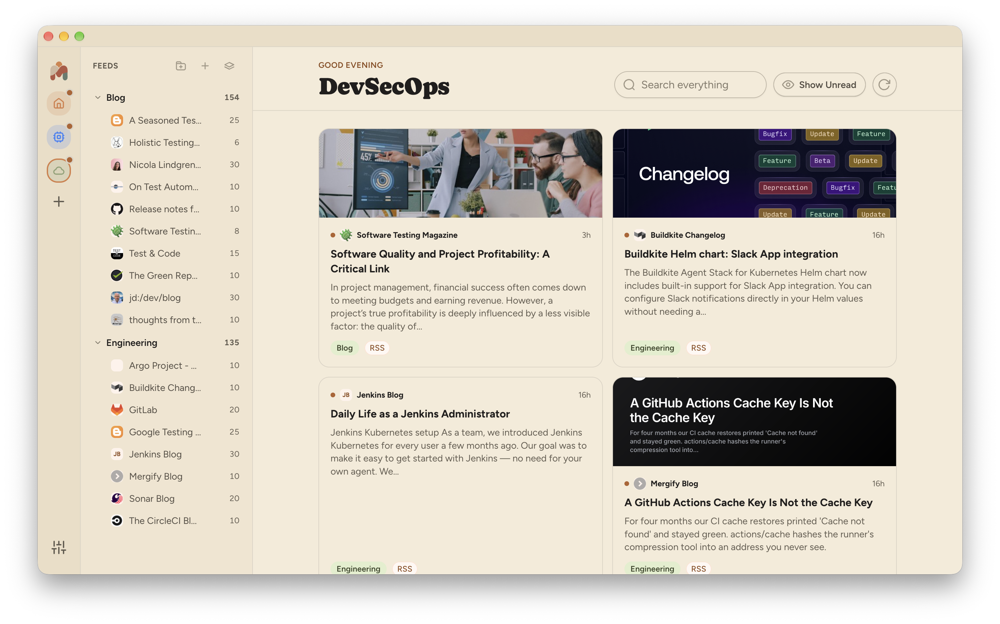
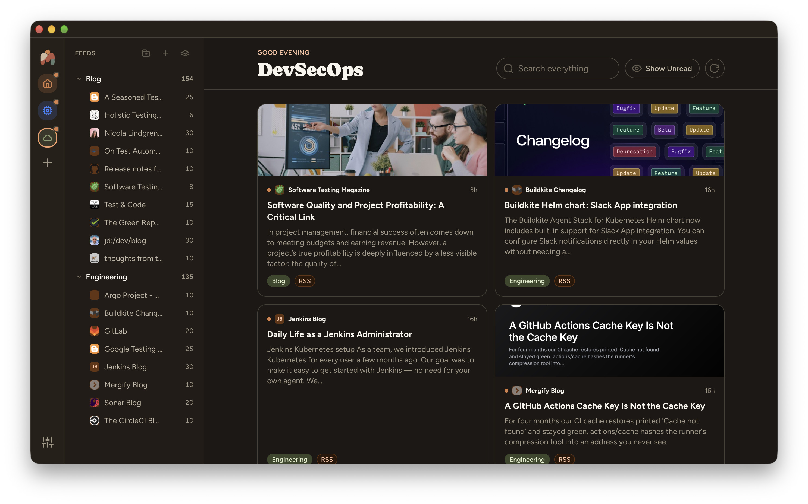
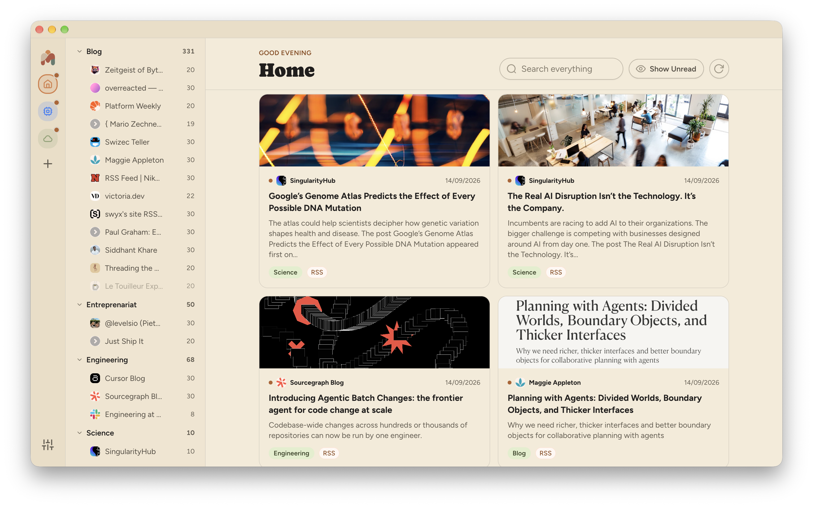

  

<h1 align="center">Monfil</h1>

Keep track of what matters to you and stay ahead.

  

  
  
  

<a href="doc/src/content/docs/user-guide/install.md">Install Monfil</a> · <a href="./feedpacks/">Browse feed packs</a> · <a href="doc/src/content/docs/contributor-guide/home.md">Contribute</a>

Monfil is a source-available, cross-platform desktop feed reader for anyone who wants to stay ahead. Keep track of what's happening in your field across 10 kinds of sources, with more to come: RSS, Substack, Google Alerts, YouTube, GitHub and GitLab releases, Hacker News, arXiv, Bluesky, and Mastodon.

Stay ahead of your competitors, new trends, and new technology without spending hours browsing, all in one unified interface.

Start with curated feed packs for topics such as "General Tech announcements and trends". Or "DevSecOps", for info about CI/CD, test automation, testing frameworks and software-supply-chain security. Or submit your own!

"Mon fil" means "My feed" in French.

➡️ ["We should bring back RSS" - Andrej Karpathy](https://x.com/karpathy/status/2018043254986703167?s=20)

➡️ ["Hate “The Algorithm?” RSS Is One of the Tools You’ve Been Looking For"](https://www.eff.org/deeplinks/2026/06/hate-algorithm-rss-one-tools-youve-been-looking)

  
  

  
  

## Problem

Keeping up with everything that's happening around us is increasingly difficult.

Important information is scattered across blogs, social networks, release notes, changelogs, YouTube channels, GitHub repositories, and security advisories. Social networks make discovery easier, but their algorithms can narrow what you see.

Monfil gives you a transparent alternative: choose your sources, organize them into workspaces, and read them in one focused place.

## Solution

Monfil combines:

- A distraction-free desktop feed reader
- Supported sources: RSS, Substack, Google Alerts, YouTube, GitHub and GitLab releases, Hacker News, arXiv, Bluesky, and Mastodon (no signup needed!)
- Feedpacks: curated source packs for specific technical fields
- Workspaces, search and read/unread tracking
- Keyboard shortcuts
- OPML import/export support

## Paste a link, Monfil finds the feed

You do not need to find a feed URL. Paste the link of the page that you read, and Monfil finds the feed behind it. When a page has more than one feed, you pick the one you want.

| Source | Paste | You follow |
| --- | --- | --- |
| Websites and blogs | Any page on the site | Its posts |
| GitHub | A repository, a user, or an organization | Releases, or public activity |
| GitLab | A project, also on a self-hosted GitLab | Releases |
| Hacker News | `news.ycombinator.com` | The front page, stories with 100+ or 300+ points, Show HN, or Ask HN |
| arXiv | A category listing, such as `arxiv.org/list/cs.AI/recent` | New papers in that category |
| Bluesky | A profile link or a handle | A person's posts |
| Mastodon | A profile link, a tag link, or `@user@server` | A person's posts, or the posts with a tag |
| YouTube | A channel, a video, or a playlist | New videos |
| Substack and Google Alerts | The publication, or the alert feed | New posts, or new alerts |

## Guides

- [Install Monfil](doc/src/content/docs/user-guide/install.md). On Windows, get it from the [Microsoft Store](https://apps.microsoft.com/detail/9P4FZNFBR29Q).
- [Use Monfil](doc/src/content/docs/user-guide/home.md)
- [Supported sources](doc/src/content/docs/user-guide/supported-sources.md)
- [Use cases](doc/src/content/docs/user-guide/use-cases.md)
- [Contribute to Monfil](doc/src/content/docs/contributor-guide/home.md)

## FAQ

**Why does this exist? Don't RSS readers already exist?**

- You choose the sources: No opaque recommendation algorithm decides what deserves your attention.
- Start with a pack: You do not need to spend hours discovering and configuring sources. Begin with a curated pack, then customize it.
- Monfil supports many sources other than RSS.
- Own your information diet: Monfil's source is available for review and built around transparency, portability, and control.

**Is my data private?**
Monfil has no account, Monfil server, or usage analytics. Your feeds, read state, and saved articles stay on your device. Fetching feeds and articles, showing remote images, and loading embeds make requests to other sites. See the [privacy notice](doc/src/content/docs/user-guide/privacy.md) for details.

**Is there a mobile app?**
Not currently. Monfil is a desktop app (macOS, Windows, Linux) built with Electron. There's no mobile version planned right now.

**Is Monfil free?**
Yes. Monfil has no ads. See the [license terms](LICENSE) for permitted uses.

**How do I report a bug or request a feature?**
Open an issue on GitHub. Read [CONTRIBUTING.md](CONTRIBUTING.md) first if you're planning to send a pull request — small, focused PRs are easiest to review.

## License

Monfil is source-available under [Business Source License 1.1](LICENSE) from v0.0.6 onward. Releases and tags before v0.0.6 remain under the original MIT license.

BUSL 1.1 permits copying, modification, redistribution, and non-production use. The Additional Use Grant also permits internal business and personal use, including modified versions. It does not permit use to offer a product or service that competes with Monfil. Only releases published by Théo Penavaire through the official repository are official Monfil releases. Contributions intended for the official project must go through that repository.

Each BUSL-licensed version automatically changes to the MIT License four years after its first release. Read the [full license](LICENSE) for the terms. Third-party code keeps its own licenses, listed in [NOTICE](NOTICE).

All new contributors must sign the [Contributor License Agreement](CLA.md) through CLA Assistant before a pull request can be merged. For licensing questions, contact <support@theopnv.com>.
