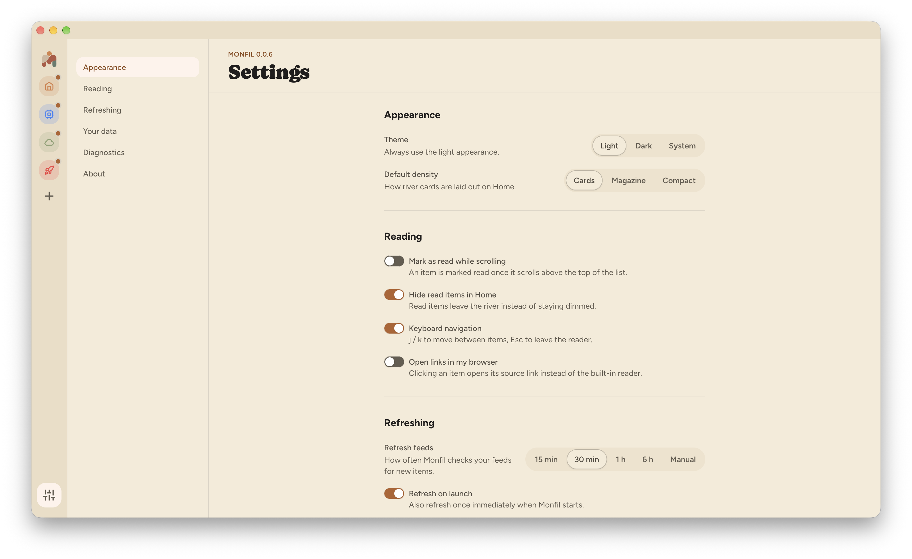

[Installieren Sie Monfil](../install/), bevor Sie anfangen. Monfil öffnet **Start**. Ihre Workspaces stehen in der schmalen Leiste links. Die nächste Seitenleiste enthält Ihre Feeds und Ordner. Artikel aus dem ausgewählten Workspace erscheinen im Hauptbereich.

## Einen Feed hinzufügen

1. Wählen Sie **+** oben in der Feed-Seitenleiste. Auf einem leeren Start können Sie stattdessen **Ersten Feed hinzufügen** wählen.
2. Fügen Sie einen Link ein: eine Website, einen Feed, ein GitHub-Repository, Hacker News, eine arXiv-Liste, einen YouTube-Kanal oder ein Bluesky- oder Mastodon-Profil. Bei einem Handle drücken Sie die **Eingabetaste**. Monfil prüft den Link und zeigt den gefundenen Feed. Führt der Link zu mehr als einem Feed, wählen Sie den gewünschten aus. Details zu jeder Quelle finden Sie unter [Unterstützte Quellen](../supported-sources/).
3. Wählen Sie **Weiter**. Wählen Sie unter **Einordnen in** einen Ordner oder wählen Sie **+ Neuer Ordner**, um einen anzulegen. Der Ordner erscheint in der Feed-Seitenleiste.
4. Wählen Sie **Quelle hinzufügen**. Monfil übernimmt die neuesten Einträge dieses Feeds. Wählen Sie **Zum Feed**, um abzuschließen, oder **Weitere hinzufügen**, um weiterzumachen.

Findet Monfil die falsche Quelle, gehen Sie zurück und versuchen Sie einen direkteren Feed- oder Kanal-Link. Über dem Ergebnis können Sie einen Quellentyp wählen, etwa **RSS**, **YouTube** oder **GitHub**, um die Suche einzugrenzen.

## Feeds ordnen

Wählen Sie das Ordnersymbol neben **+** in der Feed-Seitenleiste, um einen Ordner anzulegen. Geben Sie den Namen ein und drücken Sie die **Eingabetaste**. Ziehen Sie einen Feed auf einen Ordner, um ihn zu verschieben. Zum Umbenennen oder Löschen eines Ordners klicken Sie mit der rechten Maustaste darauf. Enthält der Ordner Feeds, fragt Monfil, wohin sie verschoben werden sollen, bevor der Ordner gelöscht wird. Klicken Sie mit der rechten Maustaste auf einen Feed, um ihn zu entfernen.

## Feeds fokussieren oder ausblenden

Klicken Sie auf einen Feed in der Seitenleiste, um nur dessen Artikel anzuzeigen. Klicken Sie auf einen weiteren Feed, um ihn dem Fokus hinzuzufügen. Klicken Sie auf einen fokussierten Feed erneut, um ihn zu entfernen. Ein Ordner hat dieselben beiden Steuerelemente: Wählen Sie die Fokus-Schaltfläche neben seinem Namen, um alle Feeds darin zu fokussieren.

Zum Ausblenden eines Feeds wählen Sie das Auge neben ihm. Das Auge erscheint, wenn Sie mit dem Zeiger auf die Zeile zeigen, und bleibt bei einem ausgeblendeten Feed sichtbar. Wählen Sie es erneut, um den Feed wieder anzuzeigen. Ein ausgeblendeter Feed bleibt nach einem Neustart von Monfil ausgeblendet.

Unter dem Titel erscheint eine Leiste, wenn ein Filter aktiv ist. **2 von 5 Feeds werden angezeigt** bedeutet, dass ein Fokus aktiv ist. **Alle anzeigen** hebt ihn auf. **3 ausgeblendete Feeds** bedeutet, dass einige Feeds ausgeblendet sind. **Anzeigen** blendet sie wieder ein. Jeder Workspace behält seinen eigenen Fokus. Monfil hebt den Fokus beim Neustart auf.

## Workspaces

Ein Workspace fasst Feeds und Ordner zu einem Thema zusammen, etwa Arbeit oder Hobbys. Jeder Workspace hat seine eigene Feed-Liste und Artikelliste. Monfil öffnet **Start**. Wählen Sie ein Workspace-Symbol in der schmalen linken Leiste, um dorthin zu wechseln. Halten Sie den Zeiger auf einem Symbol, um den Namen des Workspaces zu sehen. Drücken Sie `Cmd+1` bis `Cmd+9` (`Ctrl+1` bis `Ctrl+9` unter Windows und Linux), um die ersten neun Workspaces zu öffnen. Drücken Sie `Cmd+K` (`Ctrl+K`), um einen Workspace nach Namen zu suchen. Um die Reihenfolge der Workspaces zu ändern, ziehen Sie ein Symbol in der Leiste über oder unter ein anderes Symbol. Die Tastenkürzel folgen der neuen Reihenfolge.

### Einen Workspace hinzufügen

1. Wählen Sie **+** in der linken Leiste.
2. Geben Sie einen Namen ein. Wählen Sie ein Symbol und eine Farbe, wenn Sie die Standardwerte ändern möchten.
3. Wählen Sie **Workspace anlegen**. Monfil öffnet den neuen Workspace. Fügen Sie Feeds mit **+** in der Feed-Seitenleiste hinzu.

### Einen Workspace umbenennen oder ändern

Klicken Sie mit der rechten Maustaste auf sein Symbol in der linken Leiste und wählen Sie **Workspace bearbeiten**. Ändern Sie Name, Symbol oder Farbe und wählen Sie dann **Änderungen speichern**. Um seine Quellen zu ändern, öffnen Sie den Workspace und fügen Sie Feeds hinzu oder ordnen Sie seine Ordner in der Feed-Seitenleiste.

### Einen Workspace löschen

Klicken Sie mit der rechten Maustaste auf sein Symbol und wählen Sie **Workspace löschen**. Das Bestätigungsfenster bietet **Als OPML exportieren** an, wenn Sie seine Feed-Liste speichern möchten. Wählen Sie **Workspace löschen**, um den Workspace und seine Ordner zu entfernen. Monfil entfernt auch Feeds, die nur in diesem Workspace vorkommen. Feeds in anderen Workspaces bleiben erhalten. **Start** bleibt verfügbar und hat keinen Löschbefehl.

## Mit einem Feedpack beginnen

Ein Feedpack ist eine kuratierte Auswahl an Quellen zu einem Thema. Wählen Sie das Feedpack-Symbol oben in der Feed-Seitenleiste oder wählen Sie **Feedpacks durchsuchen**, während Sie einen Workspace anlegen. Ein leerer Workspace hat außerdem die Schaltfläche **Feedpack importieren**.

Wählen Sie ein Paket, um seine Quellen zu sehen, und wählen Sie dann **Installieren**. Öffnen Sie den Browser über die Feed-Seitenleiste, fügt Monfil das Paket dem aktuellen Workspace hinzu. Öffnen Sie ihn beim Anlegen eines Workspaces, legt Monfil für das Paket einen neuen Workspace an.

Sie können ein [Feedpack einreichen](../submit-a-feedpack/), wenn Sie eine Quellensammlung teilen möchten.

## Eine Feed-Liste importieren oder exportieren

OPML ist ein Dateiformat, mit dem Feed-Listen zwischen Readern übertragen werden. Zum Importieren öffnen Sie **Einstellungen**, wechseln Sie zu **Ihre Daten** und wählen Sie **OPML importieren**. Wählen Sie **Neuer Workspace** oder **In Start zusammenführen**, wählen Sie dann **Importieren** und die Datei aus. In einem leeren Workspace fügt **OPML importieren** die Feeds diesem Workspace hinzu.

Um einen Workspace als OPML-Datei zu speichern, klicken Sie mit der rechten Maustaste auf sein Symbol in der linken Leiste und wählen Sie **Als OPML exportieren**. Wählen Sie, wo die Datei gespeichert werden soll. Sie können sie später als Kopie der Feed-Liste dieses Workspaces verwenden.

## Artikel lesen und finden

Wählen Sie einen Artikel in der Hauptliste, um ihn im Reader von Monfil zu öffnen. Nutzen Sie **Suchen** über der Liste, um Artikel im aktuellen Workspace zu finden. Wählen Sie **Ungelesen**, um gelesene Einträge auszublenden, und wählen Sie **Alle**, um sie wieder anzuzeigen. Die Aktualisierungsschaltfläche daneben prüft Ihre Feeds auf neue Einträge.

Für die Tastatursteuerung öffnen Sie **Einstellungen** und aktivieren Sie unter **Lesen** die **Tastaturnavigation**. Dann bewegen Sie sich mit `j` und `k` zwischen Artikeln. Mit `Esc` verlassen Sie den Reader.

## Ihre Einstellungen ändern

Wählen Sie das Einstellungssymbol unten in der linken Leiste. Unter **Darstellung** wählen Sie ein Design und die Dichte der Artikelkarten. **Lesen** steuert, was beim Scrollen passiert und ob Links im Browser geöffnet werden. Unter **Aktualisierung** wählen Sie, wie oft Monfil auf neue Einträge prüft. Unter **Ihre Daten** sichern Sie die Datenbank oder zeigen ihre Datei auf Ihrem Computer an.

Lesen Sie den [Datenschutzhinweis](../privacy/) für Details zu lokalen Daten und Anfragen an andere Websites.
