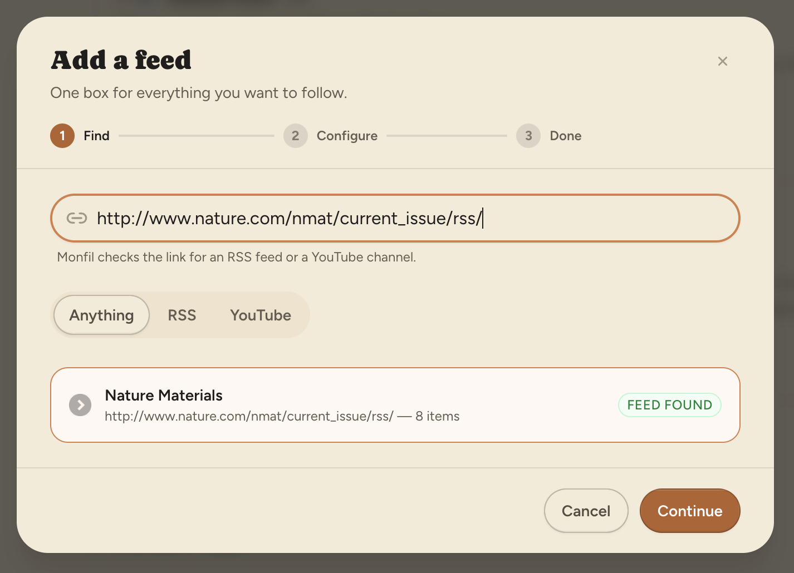

[Instala Monfil](../install/) antes de empezar. Monfil se abre en **Inicio**. Tus workspaces están en la barra estrecha de la izquierda. La siguiente barra lateral contiene tus fuentes y carpetas. Los artículos del workspace seleccionado aparecen en el área principal.

## Añadir una fuente

1. Selecciona **+** en la parte superior de la barra de fuentes. Si **Inicio** está vacío, puedes seleccionar **Añadir la primera fuente**.
2. Pega un enlace: un sitio web, una fuente, un repositorio de GitHub, Hacker News, un listado de arXiv, un canal de YouTube o un perfil de Bluesky o Mastodon. Para un nombre de usuario, pulsa Enter. Monfil revisa el enlace y muestra la fuente que encuentra. Si el enlace lleva a más de una fuente, selecciona la que quieres. Consulta [Fuentes compatibles](../supported-sources/) para ver cada tipo de fuente.
3. Selecciona **Continuar**. Elige una carpeta en **Añadir a**, o selecciona **+ Nueva carpeta** para crear una. La carpeta aparecerá en la barra de fuentes.
4. Selecciona **Añadir fuente**. Monfil añade los elementos recientes de esa fuente. Selecciona **Ir a la fuente** para terminar, o **Añadir otra** para seguir.

Si Monfil encuentra la fuente equivocada, vuelve atrás e intenta con un enlace más directo a la fuente o al canal. Puedes seleccionar un tipo de fuente, como **RSS**, **YouTube** o **GitHub**, encima del resultado para acotar la búsqueda.

## Organizar fuentes

Selecciona el icono de carpeta junto a **+** en la barra de fuentes para crear una carpeta. Escribe su nombre y pulsa **Enter**. Arrastra una fuente sobre una carpeta para moverla. Para cambiar el nombre o eliminar una carpeta, haz clic derecho sobre ella. Si la carpeta tiene fuentes, Monfil pregunta adónde moverlas antes de eliminarla. Haz clic derecho sobre una fuente para quitarla.

## Enfocar u ocultar fuentes

Haz clic en una fuente de la barra para mostrar solo sus artículos. Haz clic en otra fuente para añadirla al enfoque. Haz clic de nuevo en una fuente enfocada para quitarla del enfoque. Una carpeta tiene los mismos dos controles: selecciona el botón de enfoque junto a su nombre para enfocar todas las fuentes que contiene.

Para ocultar una fuente, selecciona el ojo junto a ella. El ojo aparece cuando apuntas a la fila, y permanece visible en una fuente oculta. Selecciónalo de nuevo para mostrar la fuente. Una fuente oculta sigue oculta después de reiniciar Monfil.

Aparece una franja debajo del título cuando hay un filtro activo. **Mostrando 2 de 5 fuentes** indica que hay un enfoque activo, y **Mostrar todas** lo quita. **3 fuentes ocultas** indica que hay fuentes ocultas, y **Mostrar** las vuelve a mostrar. Cada workspace conserva su propio enfoque. Monfil quita el enfoque cuando lo reinicias.

## Workspaces

Un workspace agrupa fuentes y carpetas alrededor de un tema, como trabajo o aficiones. Cada workspace tiene su propia lista de fuentes y su propia lista de artículos. Monfil se abre en **Inicio**. Selecciona un icono de workspace en la barra estrecha de la izquierda para cambiar a él. Mantén el puntero sobre un icono para ver el nombre del workspace. Pulsa `Cmd+1` a `Cmd+9` (`Ctrl+1` a `Ctrl+9` en Windows y Linux) para abrir los primeros nueve workspaces. Pulsa `Cmd+K` (`Ctrl+K`) para buscar un workspace por nombre. Para cambiar el orden de los workspaces, arrastra un icono encima o debajo de otro icono en la barra. Los atajos siguen el nuevo orden.

### Añadir un workspace

1. Selecciona **+** en la barra izquierda.
2. Escribe un nombre. Elige un icono y un color si quieres cambiar los valores predeterminados.
3. Selecciona **Crear workspace**. Monfil abre el workspace nuevo. Añade fuentes con **+** en la barra de fuentes.

### Cambiar el nombre o actualizar un workspace

Haz clic derecho sobre su icono en la barra izquierda y selecciona **Editar workspace**. Cambia su nombre, icono o color, y luego selecciona **Guardar cambios**. Para cambiar sus fuentes, abre el workspace y añade fuentes u organiza sus carpetas en la barra de fuentes.

### Eliminar un workspace

Haz clic derecho sobre su icono y selecciona **Eliminar workspace**. La ventana de confirmación ofrece **Exportar como OPML** si quieres guardar su lista de fuentes. Selecciona **Eliminar workspace** para quitar el workspace y sus carpetas. Monfil también quita las fuentes que aparecen solo en ese workspace. Las fuentes de otros workspaces se quedan donde están. Puedes eliminar cualquier workspace, incluido **Inicio**. Monfil conserva el último workspace que queda y muestra un error si intentas eliminarlo.

## Empezar con un feedpack

Un feedpack es un conjunto de fuentes seleccionadas sobre un tema. Selecciona el icono de feedpack en la parte superior de la barra de fuentes, o selecciona **Explorar feedpacks** mientras creas un workspace. Un workspace vacío también tiene un botón **Importar feedpack**.

Elige un pack para ver sus fuentes y luego selecciona **Instalar**. Si abres el explorador desde la barra de fuentes, Monfil añade el pack al workspace actual. Si lo abres mientras creas un workspace, Monfil crea un workspace nuevo para el pack.

Puedes [enviar un feedpack](../submit-a-feedpack/) cuando tengas una colección de fuentes para compartir.

## Importar o exportar una lista de fuentes

OPML es un formato de archivo para mover listas de fuentes entre lectores. Para importar uno, abre **Configuración**, ve a **Datos** y selecciona **Importar OPML**. Elige **Nuevo workspace** o **Combinar con** seguido del nombre del primer workspace de la barra, luego selecciona **Importar** y elige el archivo. En un workspace vacío, **Importar OPML** añade las fuentes a ese workspace.

Para guardar un workspace como archivo OPML, haz clic derecho sobre su icono en la barra izquierda y selecciona **Exportar como OPML**. Elige dónde guardar el archivo. Puedes usarlo después como copia de la lista de fuentes de ese workspace.

## Leer y buscar artículos

Selecciona un artículo en la lista principal para abrirlo en el lector de Monfil. Usa **Buscar** encima de la lista para encontrar artículos en el workspace actual. Selecciona **No leídos** para ocultar los elementos leídos, y selecciona **Todos** para volver a mostrarlos. El botón de actualizar junto a ellos busca elementos nuevos en tus fuentes.

Para los controles de teclado, abre **Configuración** y activa **Navegación con el teclado** en **Lectura**. Luego usa `j` y `k` para moverte entre artículos. Pulsa `Esc` para salir del lector.

## Cambiar tu configuración

Selecciona el icono de configuración en la parte inferior de la barra izquierda. En **Apariencia**, elige un tema, la densidad de las tarjetas de artículos y el **Idioma** de la interfaz de Monfil. Monfil sigue el idioma de tu sistema hasta que elijas uno. Está disponible en English, Français, Deutsch, Español, Italiano, Português (Brasil), 简体中文, 日本語 y العربية. Un idioma marcado como beta es una traducción automática que ningún hablante nativo ha revisado todavía. **Lectura** controla lo que ocurre al desplazarte y si los enlaces se abren en tu navegador. En **Actualización**, elige cada cuánto Monfil busca elementos nuevos. **Datos** te permite hacer una copia de seguridad de la base de datos o mostrar su archivo en tu computadora.

Lee el [aviso de privacidad](../privacy/) para conocer los detalles sobre los datos locales y las solicitudes a otros sitios.
