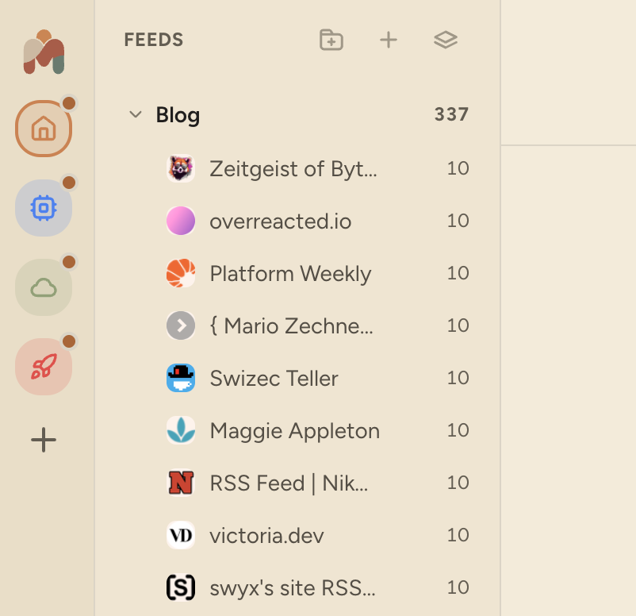

[Installez Monfil](../install/) avant de commencer. Monfil s'ouvre sur **Accueil**. Vos workspaces se trouvent dans la barre étroite à gauche. La barre latérale suivante contient vos flux et vos dossiers. Les articles du workspace sélectionné s'affichent dans la zone principale.

## Ajouter un flux

1. Sélectionnez **+** en haut de la barre latérale des flux. Sur un Accueil vide, vous pouvez sélectionner **Ajoutez votre premier flux** à la place.
2. Collez un lien : un site web, un flux, un dépôt GitHub, Hacker News, une liste arXiv, une chaîne YouTube, ou un profil Bluesky ou Mastodon. Pour un identifiant, appuyez sur Entrée. Monfil vérifie le lien et affiche le flux trouvé. Si le lien mène à plusieurs flux, sélectionnez celui que vous voulez. Voir [Sources prises en charge](../supported-sources/) pour chaque source.
3. Sélectionnez **Continuer**. Choisissez un dossier sous **Placer dans**, ou sélectionnez **+ Nouveau dossier** pour en créer un. Le dossier apparaît dans la barre latérale des flux.
4. Sélectionnez **Ajouter la source**. Monfil ajoute les éléments récents de ce flux. Sélectionnez **Aller au flux** pour terminer, ou **Ajouter une autre** pour continuer.

Si Monfil trouve la mauvaise source, revenez en arrière et essayez un lien plus direct vers le flux ou la chaîne. Vous pouvez sélectionner un type de source, comme **RSS**, **YouTube** ou **GitHub**, au-dessus du résultat pour affiner la recherche.

## Organiser les flux

Sélectionnez l'icône de dossier à côté de **+** dans la barre latérale des flux pour créer un dossier. Saisissez son nom et appuyez sur **Entrée**. Faites glisser un flux sur un dossier pour le déplacer. Pour renommer ou supprimer un dossier, faites un clic droit dessus. Si le dossier contient des flux, Monfil demande où les déplacer avant de supprimer le dossier. Faites un clic droit sur un flux pour le retirer.

## Afficher seulement certains flux ou les masquer

Cliquez sur un flux dans la barre latérale pour n'afficher que ses articles. Cliquez sur un autre flux pour l'ajouter au filtre. Cliquez à nouveau sur un flux filtré pour le retirer du filtre. Un dossier a les deux mêmes commandes : sélectionnez le bouton de filtre à côté de son nom pour filtrer tous les flux qu'il contient.

Pour masquer un flux, sélectionnez l'œil à côté de lui. L'œil apparaît quand vous pointez la ligne, et il reste visible pour un flux masqué. Sélectionnez-le à nouveau pour afficher le flux. Un flux masqué reste masqué après un redémarrage de Monfil.

Une bande apparaît sous le titre quand un filtre est actif. **Affichage de 2 flux sur 5** signifie qu'un filtre est actif, et **Tout afficher** l'annule. **3 flux masqués** signifie que certains flux sont masqués, et **Afficher** les rend visibles. Chaque workspace conserve son propre filtre. Monfil supprime le filtre quand vous le redémarrez.

## Workspaces

Un workspace regroupe des flux et des dossiers autour d'un sujet, comme le travail ou les loisirs. Chaque workspace a sa propre liste de flux et sa propre liste d'articles. Monfil s'ouvre sur **Accueil**. Sélectionnez une icône de workspace dans la barre étroite à gauche pour passer à ce workspace. Maintenez le pointeur sur une icône pour voir le nom du workspace. Appuyez sur `Cmd+1` à `Cmd+9` (`Ctrl+1` à `Ctrl+9` sous Windows et Linux) pour ouvrir les neuf premiers workspaces. Appuyez sur `Cmd+K` (`Ctrl+K`) pour trouver un workspace par son nom. Pour changer l'ordre des workspaces, faites glisser une icône au-dessus ou en dessous d'une autre icône dans la barre. Les raccourcis suivent le nouvel ordre.

### Ajouter un workspace

1. Sélectionnez **+** dans la barre de gauche.
2. Saisissez un nom. Choisissez une icône et une couleur si vous voulez changer les valeurs par défaut.
3. Sélectionnez **Créer le workspace**. Monfil ouvre le nouveau workspace. Ajoutez des flux avec **+** dans la barre latérale des flux.

### Renommer ou modifier un workspace

Faites un clic droit sur son icône dans la barre de gauche et sélectionnez **Modifier le workspace**. Changez son nom, son icône ou sa couleur, puis sélectionnez **Enregistrer les modifications**. Pour changer ses sources, ouvrez le workspace et ajoutez des flux ou organisez ses dossiers dans la barre latérale des flux.

### Supprimer un workspace

Faites un clic droit sur son icône et sélectionnez **Supprimer le workspace**. La fenêtre de confirmation propose **Exporter au format OPML** si vous voulez enregistrer sa liste de flux. Sélectionnez **Supprimer le workspace** pour retirer le workspace et ses dossiers. Monfil supprime aussi les flux qui n'apparaissent que dans ce workspace. Les flux présents dans d'autres workspaces y restent. Vous pouvez supprimer n'importe quel workspace, y compris **Accueil**. Monfil conserve le dernier workspace restant et affiche une erreur si vous essayez de le supprimer.

## Commencer avec un feedpack

Un feedpack est un ensemble de sources sélectionnées sur un sujet. Sélectionnez l'icône de feedpack en haut de la barre latérale des flux, ou sélectionnez **Parcourir les feedpacks** pendant la création d'un workspace. Un workspace vide a aussi un bouton **Importer un feedpack**.

Choisissez un feedpack pour voir ses sources, puis sélectionnez **Installer**. Quand vous ouvrez le navigateur depuis la barre latérale des flux, Monfil ajoute le feedpack au workspace en cours. Quand vous l'ouvrez pendant la création d'un workspace, Monfil crée un nouveau workspace pour le feedpack.

Vous pouvez [soumettre un feedpack](../submit-a-feedpack/) quand vous avez une collection de sources à partager.

## Importer ou exporter une liste de flux

OPML est un format de fichier pour transférer des listes de flux entre lecteurs. Pour en importer un, ouvrez **Paramètres**, allez dans **Vos données**, et sélectionnez **Importer un OPML**. Choisissez **Nouveau workspace** ou **Fusionner dans** suivi du nom du premier workspace de la barre, puis sélectionnez **Importer** et choisissez le fichier. Dans un workspace vide, **Importer un OPML** ajoute les flux à ce workspace.

Pour enregistrer un workspace dans un fichier OPML, faites un clic droit sur son icône dans la barre de gauche et sélectionnez **Exporter au format OPML**. Choisissez où enregistrer le fichier. Vous pouvez l'utiliser plus tard comme copie de la liste de flux de ce workspace.

## Lire et trouver des articles

Sélectionnez un article dans la liste principale pour l'ouvrir dans le lecteur de Monfil. Utilisez **Rechercher** au-dessus de la liste pour trouver des articles dans le workspace en cours. Sélectionnez **Non lus** pour masquer les éléments lus, et **Tous** pour les réafficher. Le bouton d'actualisation à côté vérifie vos flux pour de nouveaux éléments.

Pour les raccourcis clavier, ouvrez **Paramètres** et activez **Navigation au clavier** sous **Lecture**. Utilisez ensuite `j` et `k` pour passer d'un article à l'autre. Appuyez sur `Esc` pour quitter le lecteur.

## Modifier vos paramètres

Sélectionnez l'icône des paramètres en bas de la barre de gauche. Sous **Apparence**, choisissez un thème, la densité de disposition des cartes d'articles et la **Langue** de l'interface de Monfil. Monfil suit la langue de votre système tant que vous n'en choisissez pas une. Il existe en English, Français, Deutsch, Español, Italiano, Português (Brasil), 简体中文, 日本語 et العربية. Une langue marquée bêta est une traduction automatique qu'aucun locuteur natif n'a encore vérifiée. **Lecture** contrôle ce qui se passe quand vous faites défiler et si les liens s'ouvrent dans votre navigateur. Sous **Actualisation**, choisissez à quelle fréquence Monfil vérifie les nouveaux éléments. **Vos données** vous permet de sauvegarder la base de données ou d'afficher son fichier sur votre ordinateur.

Lisez l'[avis de confidentialité](../privacy/) pour des détails sur les données locales et les requêtes vers d'autres sites.
