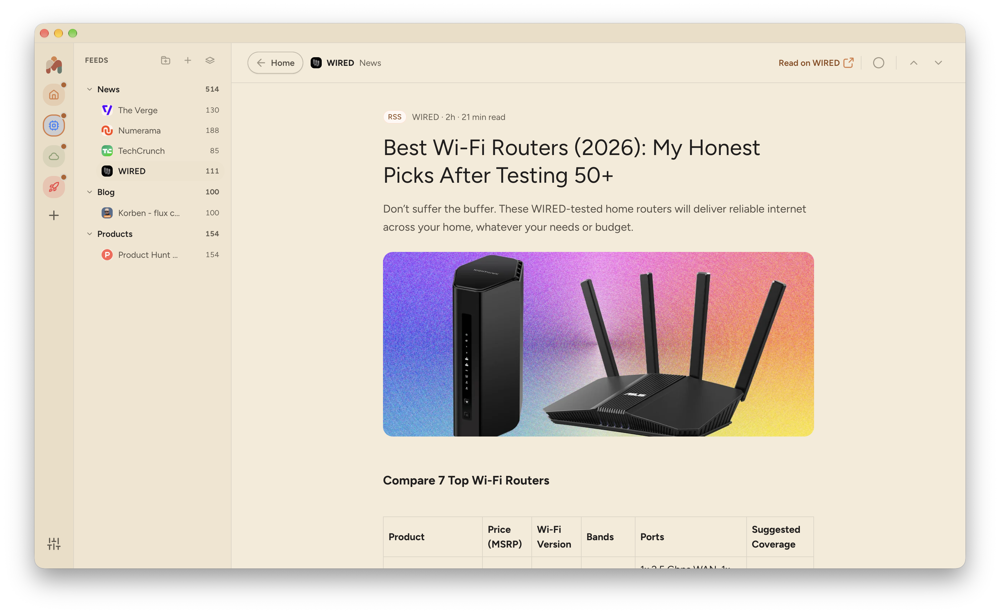

[Installa Monfil](../install/) prima di iniziare. Monfil si apre in Home. I tuoi workspace si trovano nella barra stretta a sinistra. La sidebar successiva contiene i tuoi feed e le cartelle. Gli articoli del workspace selezionato compaiono nell'area principale.

## Aggiungi un feed

1. Seleziona **+** in alto nella sidebar dei feed. Se Home è vuota, puoi selezionare **Aggiungi il primo feed**.
2. Incolla un link: un sito web, un feed, un repository GitHub, Hacker News, un elenco arXiv, un canale YouTube o un profilo Bluesky o Mastodon. Per un nome utente, premi Invio. Monfil verifica il link e mostra il feed che trova. Se il link porta a più di un feed, seleziona quello che vuoi. Consulta [Fonti supportate](../supported-sources/) per ogni fonte.
3. Seleziona **Continua**. Scegli una cartella in **Inserisci in**, oppure seleziona **+ Nuova cartella** per crearne una. La cartella comparirà nella sidebar dei feed.
4. Seleziona **Aggiungi fonte**. Monfil aggiunge gli elementi recenti di quel feed. Seleziona **Vai al feed** per finire, oppure **Aggiungi un'altra** per continuare.

Se Monfil trova la fonte sbagliata, torna indietro e prova un link più diretto al feed o al canale. Puoi selezionare un tipo di fonte, come **RSS**, **YouTube** o **GitHub**, sopra il risultato per restringere la ricerca.

## Organizza i feed

Seleziona l'icona della cartella accanto a **+** nella sidebar dei feed per creare una cartella. Scrivi il nome e premi **Invio**. Trascina un feed su una cartella per spostarlo. Per rinominare o eliminare una cartella, fai clic destro su di essa. Se la cartella contiene feed, Monfil chiede dove spostarli prima di eliminare la cartella. Fai clic destro su un feed per rimuoverlo.

## Metti a fuoco o nascondi i feed

Fai clic su un feed nella sidebar per mostrare solo i suoi articoli. Fai clic su un altro feed per aggiungerlo al fuoco. Fai clic di nuovo su un feed a fuoco per toglierlo. Una cartella ha gli stessi due comandi: seleziona il pulsante di messa a fuoco accanto al suo nome per mettere a fuoco tutti i feed che contiene.

Per nascondere un feed, seleziona l'occhio accanto a esso. L'occhio compare quando punti con il puntatore sulla riga, e resta visibile per un feed nascosto. Selezionalo di nuovo per mostrare il feed. Un feed nascosto resta nascosto anche dopo che riavvii Monfil.

Una barra compare sotto il titolo quando un filtro è attivo. **2 di 5 feed visualizzati** significa che un fuoco è attivo, e **Mostra tutti** lo annulla. **3 feed nascosti** significa che alcuni feed sono nascosti, e **Mostra** li riporta visibili. Ogni workspace mantiene il proprio fuoco. Monfil annulla il fuoco quando lo riavvii.

## Workspace

Un workspace raggruppa feed e cartelle intorno a un argomento, come lavoro o hobby. Ogni workspace ha la propria lista di feed e il proprio elenco di articoli. Monfil si apre in **Home**. Seleziona un'icona del workspace nella barra stretta a sinistra per passare a quel workspace. Tieni il puntatore su un'icona per vedere il nome del workspace. Premi `Cmd+1` fino a `Cmd+9` (`Ctrl+1` fino a `Ctrl+9` su Windows e Linux) per aprire i primi nove workspace. Premi `Cmd+K` (`Ctrl+K`) per cercare un workspace per nome. Per cambiare l'ordine dei workspace, trascina un'icona sopra o sotto un'altra icona nella barra. Le scorciatoie seguono il nuovo ordine.

### Aggiungi un workspace

1. Seleziona **+** nella barra a sinistra.
2. Scrivi un nome. Scegli un'icona e un colore se vuoi cambiare i valori predefiniti.
3. Seleziona **Crea workspace**. Monfil apre il nuovo workspace. Aggiungi feed con **+** nella sidebar dei feed.

### Rinomina o aggiorna un workspace

Fai clic destro sulla sua icona nella barra a sinistra e seleziona **Modifica workspace**. Cambia il nome, l'icona o il colore, poi seleziona **Salva modifiche**. Per cambiare le sue fonti, apri il workspace e aggiungi feed o organizza le sue cartelle nella sidebar dei feed.

### Elimina un workspace

Fai clic destro sulla sua icona e seleziona **Elimina workspace**. La finestra di conferma offre **Esporta come OPML** se vuoi salvare il suo elenco di feed. Seleziona **Elimina workspace** per rimuovere il workspace e le sue cartelle. Monfil rimuove anche i feed che compaiono solo in quel workspace. I feed presenti in altri workspace restano lì. Puoi eliminare qualsiasi workspace, anche **Home**. Monfil conserva l'ultimo workspace rimasto e mostra un errore se provi a eliminarlo.

## Inizia con un feedpack

Un feedpack è un insieme selezionato di fonti su un argomento. Seleziona l'icona del feedpack in alto nella sidebar dei feed, oppure seleziona **Sfoglia i feedpack** mentre crei un workspace. Un workspace vuoto ha anche un pulsante **Importa feedpack**.

Scegli un pacchetto per vedere le sue fonti, poi seleziona **Installa**. Quando apri il browser dalla sidebar dei feed, Monfil aggiunge il pacchetto al workspace corrente. Quando lo apri mentre crei un workspace, Monfil crea un nuovo workspace per il pacchetto.

Puoi [inviare un feedpack](../submit-a-feedpack/) quando hai una raccolta di fonti da condividere.

## Importa o esporta un elenco di feed

OPML è un formato di file per spostare elenchi di feed tra lettori. Per importarne uno, apri **Impostazioni**, vai su **I tuoi dati** e seleziona **Importa OPML**. Scegli **Nuovo workspace** oppure **Unisci a** seguito dal nome del primo workspace nella barra, poi seleziona **Importa** e scegli il file. In un workspace vuoto, **Importa OPML** aggiunge i feed a quel workspace.

Per salvare un workspace come file OPML, fai clic destro sulla sua icona nella barra a sinistra e seleziona **Esporta come OPML**. Scegli dove salvare il file. Puoi usarlo in seguito come copia dell'elenco di feed di quel workspace.

## Leggi e trova gli articoli

Seleziona un articolo nell'elenco principale per aprirlo nel lettore di Monfil. Usa **Cerca** sopra l'elenco per trovare articoli nel workspace corrente. Seleziona **Non letti** per nascondere gli elementi letti, e seleziona **Tutti** per mostrarli di nuovo. Il pulsante di aggiornamento accanto a questi controlli verifica se ci sono nuovi elementi nei tuoi feed.

Per i comandi da tastiera, apri **Impostazioni** e attiva **Navigazione da tastiera** in **Lettura**. Poi usa `j` e `k` per spostarti tra gli articoli. Premi `Esc` per uscire dal lettore.

## Cambia le impostazioni

Seleziona l'icona delle impostazioni in fondo alla barra a sinistra. In **Aspetto**, scegli un tema, la densità di disposizione delle schede degli articoli e la **Lingua** dell'interfaccia di Monfil. Monfil segue la lingua del tuo sistema finché non ne scegli una. È disponibile in English, Français, Deutsch, Español, Italiano, Português (Brasil), 简体中文, 日本語 e العربية. Una lingua contrassegnata come beta è una traduzione automatica che nessun madrelingua ha ancora controllato. **Lettura** controlla che cosa succede mentre scorri e se i link si aprono nel browser. In **Aggiornamento**, scegli ogni quanto Monfil controlla nuovi elementi. **I tuoi dati** ti permette di eseguire il backup del database o di mostrare il suo file sul computer.

Leggi l'[informativa sulla privacy](../privacy/) per i dettagli sui dati locali e sulle richieste verso altri siti.
