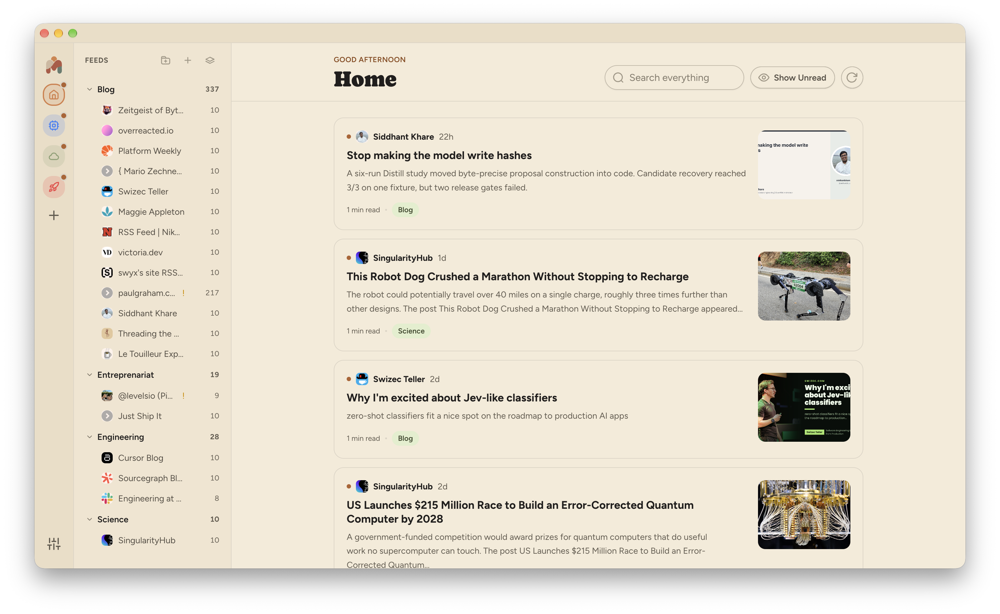

まず [Monfilをインストール](../install/) してください。Monfilはホームを開きます。ワークスペースは左側の細いレールにあります。その隣のサイドバーには、フィードとフォルダが並びます。選択したワークスペースの記事は、メイン画面に表示されます。

## フィードを追加する

1. フィードのサイドバー上部にある **+** を選択します。フィードが1つもないホームでは、代わりに **最初のフィードを追加** を選択できます。
2. リンクを貼り付けます。対象は、Webサイト、フィード、GitHub リポジトリ、Hacker News、arXiv の一覧、YouTube チャンネル、Bluesky または Mastodon のプロフィールです。ハンドルの場合は Enter を押します。Monfilがリンクを確認し、見つかったフィードを表示します。リンク先に複数のフィードがある場合は、使いたいものを選択します。ソースごとの詳細は [対応しているソース](../supported-sources/) を参照してください。
3. **続ける** を選択します。**保存先** の下でフォルダを選ぶか、**+ 新しいフォルダ** を選んで作成します。フォルダはフィードのサイドバーに表示されます。
4. **ソースを追加** を選択します。Monfilは、そのフィードの最新の項目を追加します。**フィードへ移動** を選んで終了するか、**もう1つ追加** を選んで続けます。

Monfilが誤ったソースを見つけた場合は、戻ってから、より直接的なフィードやチャンネルのリンクを試してください。結果の上にあるソースの種類（**RSS**、**YouTube**、**GitHub** など）を選ぶと、検索を絞り込めます。

## フィードを整理する

フィードのサイドバーで **+** の横にあるフォルダアイコンを選ぶと、フォルダを作成できます。フォルダ名を入力し、Enter を押します。フィードをフォルダにドラッグすると、移動します。フォルダの名前を変更または削除するには、右クリックします。フォルダにフィードがある場合、Monfilは削除する前に、フィードの移動先を尋ねます。フィードを削除するには、そのフィードを右クリックします。

## フィードを絞り込む、フィードを非表示にする

サイドバーでフィードをクリックすると、そのフィードの記事だけを表示します。別のフィードをクリックすると、そのフィードも絞り込みに加わります。絞り込み中のフィードをもう一度クリックすると、絞り込みから外れます。フォルダにも同じ2つの操作があります。フォルダ名の横にある絞り込みボタンを選ぶと、そのフォルダ内のすべてのフィードを絞り込めます。

フィードを非表示にするには、フィードの横にある目のアイコンを選びます。目のアイコンは、行にポインターを合わせると表示されます。非表示のフィードでも、目のアイコンは表示されたままです。もう一度選ぶと、フィードが再び表示されます。非表示のフィードは、Monfilを再起動しても非表示のままです。

フィルターが有効な場合、タイトルの下に帯が表示されます。**5件のフィードのうち2件を表示しています** は、絞り込みが有効であることを示します。**すべて表示** を選ぶと、絞り込みが解除されます。**非表示のフィード 3件** は、一部のフィードが非表示であることを示します。**表示** を選ぶと、非表示のフィードが戻ります。各ワークスペースは、それぞれ独自の絞り込みを保持します。Monfilを再起動すると、絞り込みは解除されます。

## ワークスペース

ワークスペースは、仕事や趣味などのテーマごとに、フィードとフォルダをまとめます。各ワークスペースには、独自のフィード一覧と記事一覧があります。Monfilは **ホーム** を開きます。左側の細いレールでワークスペースのアイコンを選ぶと、そのワークスペースに切り替わります。アイコンにポインターを合わせると、ワークスペース名が表示されます。`Cmd+1` から `Cmd+9`（Windows と Linux では `Ctrl+1` から `Ctrl+9`）を押すと、最初の9つのワークスペースを開けます。`Cmd+K`（`Ctrl+K`）を押すと、名前でワークスペースを探せます。ワークスペースの順番を変えるには、レールでアイコンを別のアイコンの上か下にドラッグします。ショートカットは、新しい順番に従います。

### ワークスペースを追加する

1. 左側のレールで **+** を選択します。
2. 名前を入力します。アイコンや色を変えたい場合は、それぞれ選択します。
3. **ワークスペースを作成** を選択します。Monfilは新しいワークスペースを開きます。フィードのサイドバーにある **+** で、フィードを追加します。

### ワークスペースの名前変更と更新

レールでワークスペースのアイコンを右クリックし、**ワークスペースを編集** を選択します。名前、アイコン、色を変更してから、**変更を保存** を選択します。ソースを変更するには、ワークスペースを開き、フィードのサイドバーでフィードを追加するか、フォルダを整理します。

### ワークスペースを削除する

アイコンを右クリックし、**ワークスペースを削除** を選択します。確認画面には、フィード一覧を保存したい場合のための **OPMLとしてエクスポート** があります。**ワークスペースを削除** を選択すると、ワークスペースとそのフォルダが削除されます。そのワークスペースにだけあるフィードも、Monfilが削除します。ほかのワークスペースにあるフィードは残ります。**ホーム** は残り、削除する操作はありません。

## フィードパックから始める

フィードパックは、あるテーマで厳選されたソースの一覧です。フィードのサイドバー上部にあるフィードパックのアイコンを選ぶか、ワークスペースの作成中に **フィードパックを探す** を選びます。空のワークスペースには、**フィードパックをインポート** ボタンもあります。

パックを選ぶと、そのソースが表示されます。**インストール** を選択します。フィードのサイドバーからフィードパックの一覧を開いた場合、Monfilはそのパックを現在のワークスペースに追加します。ワークスペースの作成中に開いた場合は、Monfilがそのパック用の新しいワークスペースを作成します。

共有したいフィードのまとまりがある場合は、[フィードパックを提出](../submit-a-feedpack/) できます。

## フィード一覧のインポートとエクスポート

OPMLは、リーダー間でフィード一覧を移動するためのファイル形式です。インポートするには、**設定** を開き、**データ** に進んで、**OPMLをインポート** を選択します。**新しいワークスペース** または **ホームに統合** を選んでから、**インポート** を選択し、ファイルを選びます。空のワークスペースでは、**OPMLをインポート** を選ぶと、そのワークスペースにフィードが追加されます。

ワークスペースをOPMLファイルとして保存するには、レールでワークスペースのアイコンを右クリックし、**OPMLとしてエクスポート** を選択します。保存先を選びます。このファイルは、そのワークスペースのフィード一覧のコピーとして後で使えます。

## 記事を読む、探す

メイン一覧で記事を選択すると、Monfilのリーダーで開きます。一覧の上にある **検索** を使うと、現在のワークスペースの記事を探せます。**未読** を選ぶと既読の項目を隠し、**すべて** を選ぶと戻します。その横の更新ボタンは、フィードに新しい項目がないかを確認します。

キーボードの操作を使うには、**設定** を開き、**閲覧** の下にある **キーボード操作** をオンにします。その後、`j` と `k` で記事を移動します。`Esc` を押すと、リーダーを閉じます。

## 設定を変更する

レールの下部にある設定アイコンを選択します。**外観** の下では、テーマ、記事カードの表示密度、Monfilの画面の **言語** を選べます。言語を選ぶまでは、システムの言語に従います。English、Français、Deutsch、Español、Italiano、Português (Brasil)、简体中文、日本語、العربية で使えます。ベータと表示された言語は機械翻訳で、ネイティブスピーカーがまだ確認していません。**閲覧** では、スクロールに合わせた動作と、リンクをブラウザーで開くかどうかを設定します。**更新** では、Monfilが新しい項目を確認する頻度を選べます。**データ** では、データベースをバックアップしたり、コンピューター上のデータベースファイルを表示したりできます。

ローカルのデータと、ほかのサイトへのリクエストについては、[プライバシーに関するお知らせ](../privacy/) を読んでください。
