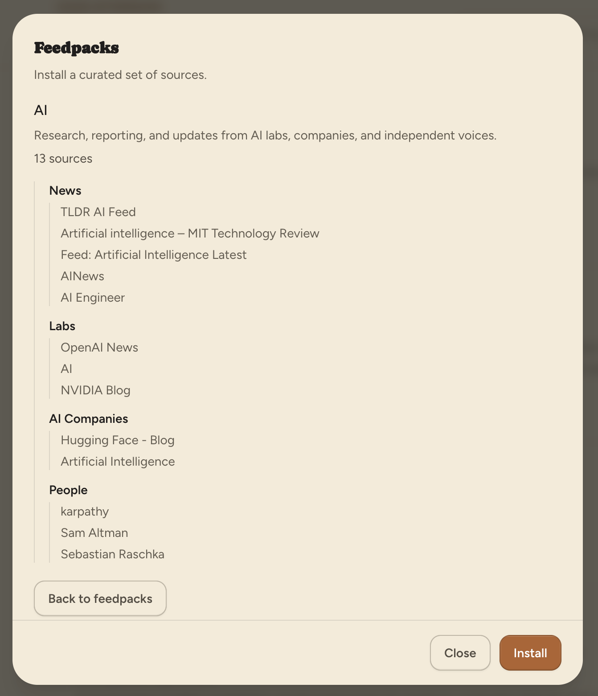
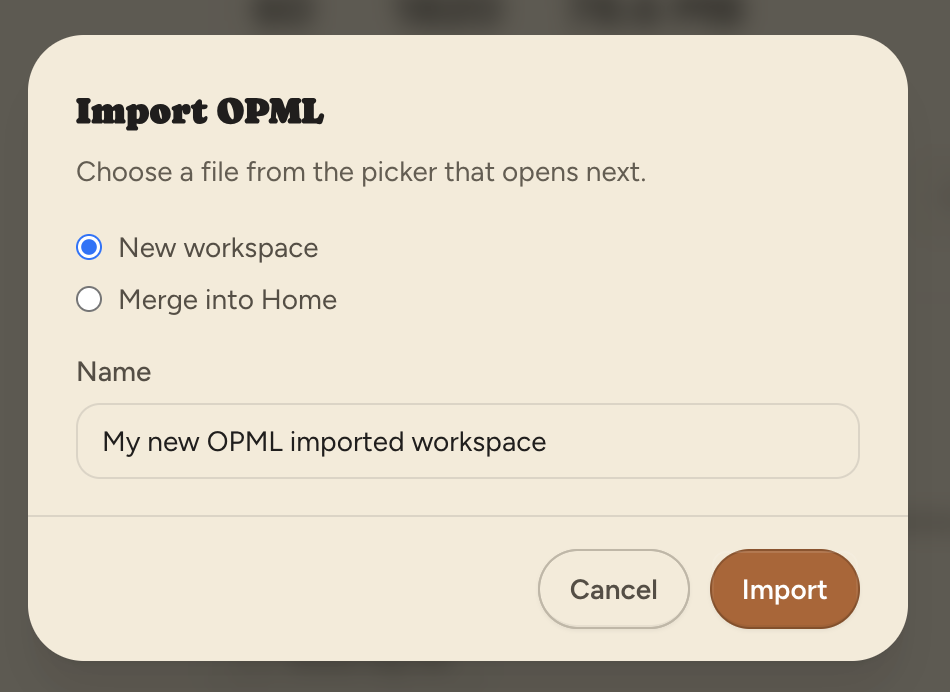

[Instale o Monfil](../install/) antes de começar. O Monfil abre em **Início**. Os seus workspaces ficam na barra estreita à esquerda. A barra seguinte mostra os seus feeds e pastas. Os artigos do workspace selecionado aparecem na área principal.

## Adicionar um feed

1. Selecione **+** no topo da barra de feeds. Em um **Início** vazio, você pode selecionar **Adicionar seu primeiro feed** no lugar.
2. Cole um link: um site, um feed, um repositório do GitHub, o Hacker News, uma listagem do arXiv, um canal do YouTube ou um perfil do Bluesky ou do Mastodon. Para um identificador, pressione Enter. O Monfil verifica o link e mostra o feed que encontra. Se o link levar a mais de um feed, selecione o que você quer. Veja [Fontes compatíveis](../supported-sources/) para cada fonte.
3. Selecione **Continuar**. Escolha uma pasta em **Colocar em**, ou selecione **+ Nova pasta** para criar uma. A pasta aparece na barra de feeds.
4. Selecione **Adicionar fonte**. O Monfil adiciona os itens recentes desse feed. Selecione **Ir para o feed** para terminar, ou **Adicionar outra** para continuar.

Se o Monfil encontrar a fonte errada, volte e tente um link mais direto para o feed ou para o canal. Você pode selecionar um tipo de fonte, como **RSS**, **YouTube** ou **GitHub**, acima do resultado para restringir a busca.

## Organizar feeds

Selecione o ícone de pasta ao lado de **+** na barra de feeds para criar uma pasta. Digite o nome e pressione **Enter**. Arraste um feed para uma pasta para movê-lo. Para renomear ou excluir uma pasta, clique com o botão direito nela. Se a pasta tiver feeds, o Monfil pergunta para onde movê-los antes de excluir a pasta. Clique com o botão direito em um feed para removê-lo.

## Focar ou ocultar feeds

Clique em um feed na barra para mostrar só os artigos dele. Clique em outro feed para adicioná-lo ao foco. Clique de novo em um feed focado para removê-lo do foco. Uma pasta tem os mesmos dois controles: selecione o botão de foco ao lado do nome para focar todos os feeds dela.

Para ocultar um feed, selecione o olho ao lado dele. O olho aparece quando você aponta para a linha, e continua visível para um feed oculto. Selecione-o de novo para mostrar o feed. Um feed oculto continua oculto depois que você reinicia o Monfil.

Uma faixa aparece abaixo do título quando um filtro está ativo. **Mostrando 2 de 5 feeds** significa que um foco está ativo, e **Mostrar todos** limpa o foco. **3 feeds ocultos** significa que alguns feeds estão ocultos, e **Mostrar** os traz de volta. Cada workspace mantém o próprio foco. O Monfil limpa o foco quando você o reinicia.

## Workspaces

Um workspace agrupa feeds e pastas em torno de um assunto, como trabalho ou hobbies. Cada workspace tem a própria lista de feeds e a própria lista de artigos. O Monfil abre em **Início**. Selecione um ícone de workspace na barra estreita à esquerda para trocar de workspace. Mantenha o ponteiro sobre um ícone para ver o nome do workspace. Pressione `Cmd+1` a `Cmd+9` (`Ctrl+1` a `Ctrl+9` no Windows e no Linux) para abrir os primeiros nove workspaces. Pressione `Cmd+K` (`Ctrl+K`) para buscar um workspace pelo nome. Para mudar a ordem dos workspaces, arraste um ícone para cima ou para baixo de outro ícone na barra. Os atalhos seguem a nova ordem.

### Adicionar um workspace

1. Selecione **+** na barra à esquerda.
2. Digite um nome. Escolha um ícone e uma cor se quiser mudar os padrões.
3. Selecione **Criar workspace**. O Monfil abre o novo workspace. Adicione feeds com **+** na barra de feeds.

### Renomear ou atualizar um workspace

Clique com o botão direito no ícone do workspace na barra à esquerda e selecione **Editar workspace**. Mude o nome, o ícone ou a cor, depois selecione **Salvar alterações**. Para mudar as fontes, abra o workspace e adicione feeds ou organize as pastas na barra de feeds.

### Excluir um workspace

Clique com o botão direito no ícone do workspace e selecione **Excluir workspace**. A janela de confirmação oferece **Exportar como OPML** se você quiser salvar a lista de feeds. Selecione **Excluir workspace** para remover o workspace e as pastas dele. O Monfil também remove os feeds que aparecem só nesse workspace. Os feeds de outros workspaces continuam lá. Você pode excluir qualquer workspace, inclusive **Início**. O Monfil mantém o último workspace restante e mostra um erro se você tentar excluí-lo.

## Comece com um feedpack

Um feedpack é um conjunto selecionado de fontes sobre um assunto. Selecione o ícone de feedpack no topo da barra de feeds, ou selecione **Explorar feedpacks** ao criar um workspace. Um workspace vazio também tem um botão **Importar feedpack**.

Escolha um pacote para ver as fontes dele e depois selecione **Instalar**. Quando você abre o explorador pela barra de feeds, o Monfil adiciona o pacote ao workspace atual. Quando você o abre ao criar um workspace, o Monfil cria um workspace novo para o pacote.

Você pode [enviar um feedpack](../submit-a-feedpack/) quando tiver uma coleção de fontes para compartilhar.

## Importar ou exportar uma lista de feeds

OPML é um formato de arquivo para mover listas de feeds entre leitores. Para importar um, abra **Configurações**, vá em **Seus dados** e selecione **Importar OPML**. Escolha **Novo workspace** ou **Mesclar com** seguido do nome do primeiro workspace da barra, depois selecione **Importar** e escolha o arquivo. Em um workspace vazio, **Importar OPML** adiciona os feeds a esse workspace.

Para salvar um workspace como arquivo OPML, clique com o botão direito no ícone dele na barra à esquerda e selecione **Exportar como OPML**. Escolha onde salvar o arquivo. Depois você pode usá-lo como cópia da lista de feeds desse workspace.

## Ler e buscar artigos

Selecione um artigo na lista principal para abri-lo no leitor do Monfil. Use **Buscar** acima da lista para encontrar artigos no workspace atual. Selecione **Não lidos** para ocultar os itens lidos, e selecione **Todos** para trazê-los de volta. O botão de atualizar ao lado dele verifica seus feeds em busca de novos itens.

Para os controles de teclado, abra **Configurações** e ative **Navegação pelo teclado** em **Leitura**. Depois use `j` e `k` para mover entre os artigos. Pressione `Esc` para sair do leitor.

## Mudar as configurações

Selecione o ícone de configurações na parte inferior da barra à esquerda. Em **Aparência**, escolha um tema, a densidade dos cards de artigos e o **Idioma** da interface do Monfil. O Monfil segue o idioma do seu sistema até você escolher um. Ele está disponível em English, Français, Deutsch, Español, Italiano, Português (Brasil), 简体中文, 日本語 e العربية. Um idioma marcado como beta é uma tradução automática que nenhum falante nativo revisou ainda. **Leitura** controla o que acontece ao rolar a lista e se os links abrem no seu navegador. Em **Atualização**, escolha a frequência com que o Monfil verifica novos itens. **Seus dados** permite fazer backup do banco de dados ou mostrar o arquivo dele no computador.

Leia o [aviso de privacidade](../privacy/) para ver detalhes sobre os dados locais e sobre as requisições a outros sites.
