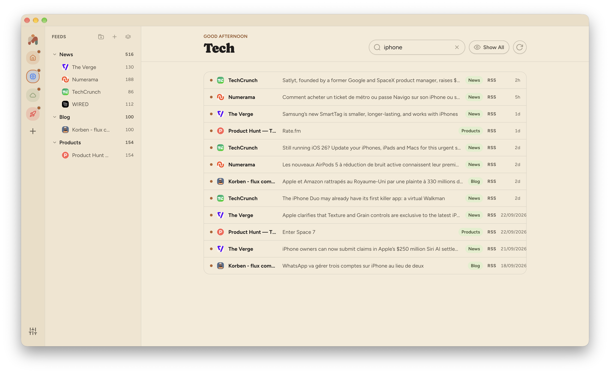

开始前请先[安装 Monfil](../install/)。Monfil 会打开首页。你的 Workspace 位于左侧的窄栏中。下一栏是你的订阅源和文件夹。所选 Workspace 中的文章会显示在主区域。

## 添加订阅源

1. 选择订阅源栏顶部的 **+**。如果首页为空，你也可以选择 **添加你的第一个订阅源**。
2. 粘贴一个链接：网站、订阅源、GitHub 代码仓库、Hacker News、arXiv 列表、YouTube 频道，或 Bluesky 或 Mastodon 主页。输入账号名时，按 **回车** 键。Monfil 会检查链接并显示它找到的订阅源。如果链接指向多个订阅源，请选择你想要的那一个。各来源的说明请见[支持的来源](../supported-sources/)。
3. 选择 **继续**。在 **放入** 下选择一个文件夹，或选择 **+ 新建文件夹** 来创建一个。该文件夹会出现在订阅源栏中。
4. 选择 **添加订阅源**。Monfil 会添加该订阅源的最新内容。选择 **前往订阅源** 完成，或选择 **再添加一个** 继续添加。

如果 Monfil 找到了错误的来源，请返回并尝试更直接的订阅源或频道链接。你可以在结果上方选择一个来源类型，例如 **RSS**、**YouTube** 或 **GitHub**，以缩小搜索范围。

## 整理订阅源

选择订阅源栏中 **+** 旁边的文件夹图标，即可创建文件夹。输入名称并按 **回车** 键。将订阅源拖到文件夹上即可移动它。要重命名或删除文件夹，请右键单击它。如果文件夹中有订阅源，Monfil 会在删除前询问要把它们移到哪里。右键单击订阅源即可将其移除。

## 聚焦或隐藏订阅源

单击订阅源栏中的订阅源，即可只显示其文章。再单击另一个订阅源，即可将其加入聚焦。再次单击已聚焦的订阅源，即可取消聚焦。文件夹有相同的两个控件：选择其名称旁边的聚焦按钮，即可聚焦其中的每个订阅源。

要隐藏订阅源，请选择其旁边的眼睛图标。指针悬停在该行上时会出现眼睛图标，隐藏的订阅源也会保持显示该图标。再次选择即可重新显示该订阅源。重启 Monfil 后，隐藏的订阅源仍保持隐藏。

启用筛选时，标题下方会出现一条提示栏。**正在显示 5 个订阅源中的 2 个** 表示聚焦已启用。**全部显示** 会清除聚焦。**3 个已隐藏的订阅源** 表示部分订阅源已隐藏。**显示** 会将它们重新显示。每个 Workspace 保留各自的聚焦。Monfil 重启后会清除聚焦。

## Workspace

Workspace 会围绕一个主题（例如工作或爱好）将订阅源和文件夹分组。每个 Workspace 都有自己的订阅源列表和文章列表。Monfil 会打开 **首页**。选择左侧窄栏中的 Workspace 图标即可切换。将指针悬停在图标上，即可看到 Workspace 名称。按 `Cmd+1` 至 `Cmd+9`（Windows 和 Linux 上为 `Ctrl+1` 至 `Ctrl+9`），即可打开前九个 Workspace。按 `Cmd+K`（`Ctrl+K`），即可按名称查找 Workspace。要更改 Workspace 的顺序，请将图标拖到栏中另一个图标的上方或下方。快捷键会跟随新的顺序。

### 添加 Workspace

1. 选择左侧栏中的 **+**。
2. 输入名称。如果你想更改默认值，请选择图标和颜色。
3. 选择 **创建Workspace**。Monfil 会打开新的 Workspace。使用订阅源栏中的 **+** 添加订阅源。

### 重命名或更新 Workspace

右键单击左侧栏中的图标，然后选择 **编辑Workspace**。更改其名称、图标或颜色，然后选择 **保存更改**。要更改其来源，请打开该 Workspace，然后在订阅源栏中添加订阅源或整理其文件夹。

### 删除 Workspace

右键单击其图标，然后选择 **删除Workspace**。如果你想保存其订阅源列表，确认窗口会提供 **导出为 OPML**。选择 **删除Workspace**，即可删除该 Workspace 及其文件夹。Monfil 还会删除只出现在该 Workspace 中的订阅源。其他 Workspace 中的订阅源会保留。**首页** 始终可用，且没有删除命令。

## 从 Feedpack 开始

Feedpack 是围绕一个主题的一组精选来源。选择订阅源栏顶部的 Feedpack 图标，或在创建 Workspace 时选择 **浏览Feedpack**。空的 Workspace 还有一个 **导入Feedpack** 按钮。

选择一个 Feedpack 以查看其来源，然后选择 **安装**。从订阅源栏打开浏览器时，Monfil 会把该 Feedpack 添加到当前 Workspace。在创建 Workspace 时打开它，Monfil 会为该 Feedpack 新建一个 Workspace。

当你有想要分享的订阅源集合时，可以[提交 Feedpack](../submit-a-feedpack/)。

## 导入或导出订阅源列表

OPML 是一种在阅读器之间迁移订阅源列表的文件格式。要导入，请打开 **设置**，进入 **你的数据**，然后选择 **导入 OPML**。选择 **新建Workspace** 或 **合并到首页**，然后选择 **导入**，并选择文件。在空的 Workspace 中，**导入 OPML** 会将订阅源添加到该 Workspace。

要将 Workspace 保存为 OPML 文件，请右键单击左侧栏中的图标，然后选择 **导出为 OPML**。选择保存文件的位置。之后你可以将它用作该 Workspace 订阅源列表的副本。

## 阅读和查找文章

在主列表中选择一篇文章，即可在 Monfil 的阅读器中打开。使用列表上方的 **搜索**，可在当前 Workspace 中查找文章。选择 **未读** 可隐藏已读项目，选择 **全部** 可将其重新显示。旁边的刷新按钮会检查订阅源是否有新内容。

要使用键盘操作，请打开 **设置**，并在 **阅读** 下开启 **键盘导航**。然后使用 `j` 和 `k` 在文章之间移动。按 `Esc` 离开阅读器。

## 更改设置

选择左侧栏底部的设置图标。在 **外观** 下，选择主题和文章卡片的布局密度。**阅读** 控制滚动时会发生什么，以及链接是否在浏览器中打开。在 **刷新** 下，选择 Monfil 检查新内容的频率。**你的数据** 可让你备份数据库，或在计算机上显示其文件。

请阅读[隐私声明](../privacy/)，了解本地数据以及向其他网站发出请求的详细信息。
